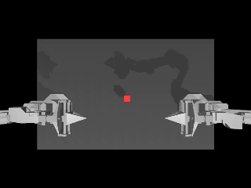
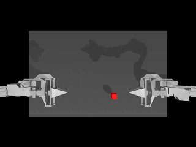
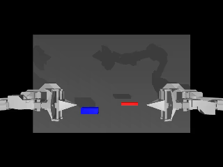
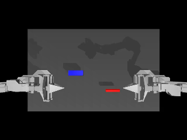

# Visual robustness of learned manipulation policies (ALOHA sim)

<table align="center">
  <tr>
    <td align="center" width="50%">
      <br>
      <b>Success</b> (seed 1004)<br>
      <sub>The cube is lifted and passed to the left arm.</sub>
    </td>
    <td align="center" width="50%">
      <br>
      <b>Failure</b> (seed 1005)<br>
      <sub>The cube is lifted but lost before the handover.</sub>
    </td>
  </tr>
</table>

<p align="center"><sub><b>Transfer Cube:</b> pass a cube from the right arm to the left arm.</sub></p>

<table align="center">
  <tr>
    <td align="center" width="50%">
      <br>
      <b>Success</b> (seed 1001)<br>
      <sub>Peg and socket are lifted, brought together and the peg is inserted.</sub>
    </td>
    <td align="center" width="50%">
      <br>
      <b>Failure</b> (seed 1000)<br>
      <sub>Peg and socket are brought together, but the peg is not inserted before the time limit.</sub>
    </td>
  </tr>
</table>

<p align="center"><sub><b>Insertion</b> (main task): pick up a red peg and a blue socket and insert the peg in mid-air.</sub></p>

<p align="center"><sub>Pretrained ACT models, from the 50-episode baseline evaluations below.<br>The view is the top camera, the only image the policy sees.</sub></p>

> **Status: work in progress.** The setup, the pretrained baselines on both tasks and the first own training run (ACT on Transfer Cube) are done; own ACT on Insertion, SmolVLA, perturbations and the main comparison are still being built. Results are added only when the runs behind them are finished.

## Question

How robust are learned robot manipulation policies to visual changes that happen on a real factory floor, such as different lighting, a shifted camera or clutter on the table?

## Approach

Two policies are trained by imitation learning on the same simulated task and evaluated first in the standard scene, then under controlled visual perturbations.

| | |
|---|---|
| Policy A | ACT (Action Chunking Transformer) |
| Policy B | SmolVLA, fine-tuned from `lerobot/smolvla_base` |
| Framework | [Hugging Face LeRobot](https://github.com/huggingface/lerobot) |
| Simulator | ALOHA bimanual robot in MuJoCo ([gym-aloha](https://github.com/huggingface/gym-aloha)) |
| Tasks | Transfer Cube (pipeline check), Insertion (main experiment) |
| Perturbations (planned) | lighting, camera pose, distractor objects, table colour; 2-3 severity levels each |

Each condition is evaluated for 50 episodes with fixed seeds, and both policies see the same seeds.

## Progress

- [x] Setup verified: GPU, LeRobot, headless MuJoCo rendering
- [x] Baseline: pretrained ACT on Transfer Cube
- [x] Train own ACT on Transfer Cube (Colab)
- [x] Baseline: pretrained ACT on Insertion
- [ ] Train own ACT on Insertion
- [ ] Fine-tune SmolVLA on Insertion
- [ ] Visual perturbations
- [ ] Evaluation harness (per-episode CSV, resumable)
- [ ] Analysis and write-up

## Results so far

### Baseline: pretrained ACT, Transfer Cube, standard scene

| Policy | Task | Episodes | Seeds | Success | 95% CI |
|---|---|---|---|---|---|
| `lerobot/act_aloha_sim_transfer_cube_human` | AlohaTransferCube-v0 | 50 | 1000-1049 | 38/50 (76.0%) | 62.6-85.7% |

Highest reward stage reached per episode:

| Stage | Meaning | Episodes |
|---|---|---|
| 0 | cube never touched | 1 |
| 1 | right gripper touched the cube | 3 |
| 2 | cube lifted, no handover | 8 |
| 4 | success | 38 |

Most failures happen at the handover between the two arms, not at the first grasp.

Raw output: [`analysis/results/phase1_act_pretrained_transfer_cube.json`](analysis/results/phase1_act_pretrained_transfer_cube.json)

### Own ACT, Transfer Cube, standard scene

ACT trained in Google Colab (T4) on the dataset `lerobot/aloha_sim_transfer_cube_human`, with the same settings as the pretrained model (ResNet-18 image backbone initialised from ImageNet, the rest of the network from random weights): 100,000 steps, batch size 8, learning rate 1e-5, chunk size 100, seed 1000. Checkpoints were saved to the Hub every 10,000 steps, and training was resumed from them across three Colab sessions.

Model: [`Wolvered/act_aloha_transfer_cube`](https://huggingface.co/Wolvered/act_aloha_transfer_cube)

| Policy | Task | Episodes | Seeds | Success | 95% CI |
|---|---|---|---|---|---|
| `Wolvered/act_aloha_transfer_cube` | AlohaTransferCube-v0 | 50 | 1000-1049 | 34/50 (68.0%) | 54.2-79.2% |

Highest reward stage reached per episode:

| Stage | Meaning | Episodes |
|---|---|---|
| 0 | cube never touched | 0 |
| 1 | right gripper touched the cube | 6 |
| 2 | cube lifted, no handover | 10 |
| 4 | success | 34 |

As with the pretrained model, most failures happen at the handover.

Comparison with the pretrained model on the same 50 seeds:

| | Episodes |
|---|---|
| both succeed | 31 |
| both fail | 9 |
| only pretrained succeeds | 7 |
| only own model succeeds | 3 |

The own model is 4 episodes (8 percentage points) below the pretrained model. The confidence intervals overlap, and an exact McNemar test on the 10 seeds where the two models disagree gives p = 0.34, so the difference is not statistically meaningful at 50 episodes. The training recipe reproduces the pretrained baseline within the precision of this evaluation.

Raw output: [`analysis/results/phase2_act_own_transfer_cube.json`](analysis/results/phase2_act_own_transfer_cube.json)

### Baseline: pretrained ACT, Insertion, standard scene

Insertion is the main task of the experiment: one arm picks up a peg, the other a socket, and the peg has to be inserted in mid-air.

| Policy | Task | Episodes | Seeds | Success | 95% CI |
|---|---|---|---|---|---|
| `lerobot/act_aloha_sim_insertion_human` | AlohaInsertion-v0 | 50 | 1000-1049 | 9/50 (18.0%) | 9.8-30.8% |

Highest reward stage reached per episode:

| Stage | Meaning | Episodes |
|---|---|---|
| 0 | the two grippers never touch peg and socket at the same time | 12 |
| 1 | both grippers touch peg and socket | 8 |
| 2 | peg and socket both grasped and lifted | 2 |
| 3 | peg touches the socket in the air, not inserted | 19 |
| 4 | success: peg touches the pin inside the socket | 9 |

Insertion is much harder than Transfer Cube for the same kind of model (18% against 76%). Failures cluster at two points: the final precise insertion (stage 3, 19 episodes) and the first grasp of both objects (stage 0, 12 episodes).

Raw output: [`analysis/results/phase3_act_pretrained_insertion.json`](analysis/results/phase3_act_pretrained_insertion.json)

## Notes on the evaluation

- **Success criterion.** For Transfer Cube, gym-aloha counts an episode as a success as soon as the left gripper touches the cube while the cube is off the table, and ends the episode at that moment. A fingertip touch counts the same as a full two-handed grasp, so the success rate is optimistic compared with a completed handover. All policies and conditions are scored with the same rule. For Insertion, an episode counts as a success when the peg touches the pin inside the socket.
- **Episode length.** `lerobot-eval` stops every ALOHA episode after 400 steps (8 s). The Insertion demonstrations are 500 steps long, so a policy that moves at human speed can run out of time. This is LeRobot's default setting and applies to every policy and condition in this project.
- **Checkpoint format.** The pretrained checkpoints on the Hub were saved by an older LeRobot version. Each is converted locally with LeRobot's `migrate_policy_normalization.py`, which moves the normalization statistics out of the weights; the network weights are unchanged. The own model was trained with the current LeRobot version and is evaluated directly from the Hub.
- **Uncertainty.** With 50 episodes per condition the 95% confidence interval spans up to about ±14 percentage points, so small differences between conditions are not meaningful.

## Repository layout

```
eval/
  phase1_baseline.sh      pretrained ACT baseline with lerobot-eval
  evaluate.sh             evaluate any policy on an ALOHA task with the same settings
scripts/
  check_setup.py          checks Python env, GPU, LeRobot and headless rendering
  view_scene.sh           opens a task scene in the MuJoCo 3D viewer
  watch_policy.py         watch a policy control the robot live in the viewer
  make_gif.py             turn an evaluation video into a small GIF for this README
analysis/results/         raw evaluation outputs (every reported number comes from here)
media/                    GIFs (and later plots) for this README
perturbations/            visual scene changes (planned)
notebooks/
  train_colab.ipynb       train ACT in Google Colab, checkpoints pushed to the Hub
```

## How to reproduce

Requirements: Linux or WSL2, an NVIDIA GPU, conda, and LeRobot installed from source with the `aloha` extra.

```bash
conda activate lerobot

# 1. check the setup
MUJOCO_GL=egl python scripts/check_setup.py

# 2. pretrained ACT baseline (50 episodes, about 40 min on a GTX 1650)
bash eval/phase1_baseline.sh

# 3. pretrained ACT baseline on Insertion (50 episodes, about 52 min on a GTX 1650)
python ~/lerobot/src/lerobot/processor/migrate_policy_normalization.py \
    --pretrained-path lerobot/act_aloha_sim_insertion_human \
    --output-dir outputs/models/act_aloha_sim_insertion_human_migrated
bash eval/evaluate.sh outputs/models/act_aloha_sim_insertion_human_migrated AlohaInsertion-v0 phase3_act_pretrained_insertion

# 4. train ACT: open notebooks/train_colab.ipynb in Google Colab (T4)

# 5. evaluate the trained model (50 episodes, about 42 min on a GTX 1650)
bash eval/evaluate.sh Wolvered/act_aloha_transfer_cube AlohaTransferCube-v0 phase2_act_own_transfer_cube

# optional: look at the scene, or watch the policy live (needs a display)
bash scripts/view_scene.sh
python scripts/watch_policy.py --episodes 3
```

## Environment

| | |
|---|---|
| LeRobot | 0.6.2, commit `8c920c4270460851cedd2737657584586d3dc66f` |
| PyTorch | 2.11.0 (CUDA 13.0) |
| MuJoCo | 3.8.1 |
| Python | 3.12 |
| Local GPU | NVIDIA GTX 1650, 4 GB (evaluation only) |
| Training | Google Colab, T4 |
